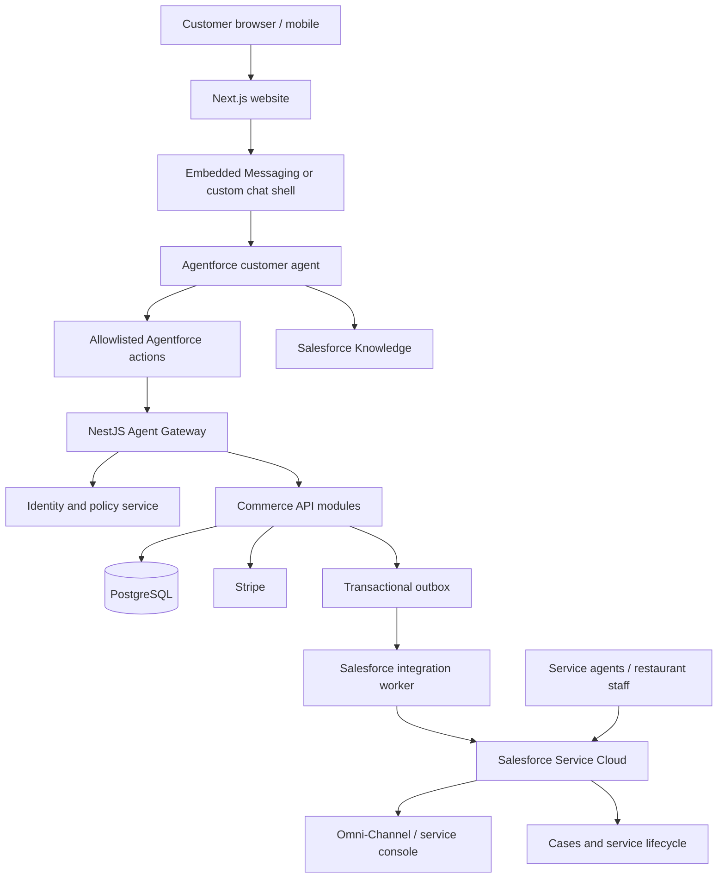

# 01 — End-to-End Salesforce + Agentforce Solution Architecture

## 1. Context

Mylapore Express is a multi-outlet restaurant commerce platform. The public website is Next.js; the commerce backend is NestJS; PostgreSQL is the commerce database; Stripe handles payment processing. Salesforce provides CRM and service operations. Agentforce provides conversational assistance and controlled orchestration.

## 2. Logical architecture

## 3. System responsibility matrix

| Capability | System of record | Salesforce responsibility | Agent responsibility |
|---|---|---|---|
| Menu and item images | NestJS/PostgreSQL or catalog service | Optional read-only summary/cache | Discover and explain |
| Current price/tax | NestJS pricing | No price authority | Present backend result |
| Inventory/availability | NestJS/PostgreSQL | Optional alert/report | Check availability |
| Cart/quote/checkout | NestJS | Link/context only | Guide; never create payment proof |
| Payment | Stripe + backend projection | Case/support visibility | Explain verified status |
| Order | NestJS/PostgreSQL | External order reference and service context | Lookup own order, request allowed action |
| Refund | Backend + Stripe | Case, approval/work queue if designed | Check eligibility/request; no false completion |
| Customer profile | Identity service + Salesforce CRM mapping | Contact/Account/consent/service context | Use only verified profile context |
| Support Case | Salesforce | System of record | Create/update approved Case |
| Knowledge | Salesforce Knowledge | System of record | Ground answers |
| Human routing | Salesforce | Omni-Channel/queues | Transfer with context |
| Agent interaction | Salesforce interaction record/logging strategy | Governed service history | Summarize and hand off |

## 4. Integration patterns

### Synchronous request/response
Use for customer-facing reads where the user needs an immediate answer:
- menu discovery;
- item detail/availability;
- own order status;
- delivery coverage;
- cancellation/reschedule preview;
- support Case creation acknowledgement.

### Asynchronous event delivery
Use for:
- order-created/updated notifications;
- payment/refund outcome updates;
- Salesforce Case context updates;
- loyalty or marketing events;
- POS/KDS/delivery provider updates.

Use outbox in NestJS and idempotent Salesforce upsert by external ID. Salesforce outages must not roll back a paid order.

## 5. Authentication patterns

### Website to Agentforce
Choose one supported channel pattern after a proof of concept:
1. Salesforce Messaging for In-App and Web / Embedded Messaging with supported authenticated-user verification; or
2. Custom website chat UI calling a backend-for-frontend that invokes the supported Agent API.

Do not assume a browser can safely call privileged Salesforce or NestJS endpoints with a secret.

### Agentforce to NestJS
- Salesforce Named Credential / External Credential or an approved secure integration mechanism.
- OAuth 2.0 client credentials or JWT bearer where supported by the selected integration design.
- Backend validates issuer, audience, signature, expiry, scopes and replay controls.
- Use separate credentials per environment.
- Never trust a customer ID passed by the LLM.

### NestJS to Salesforce
- Dedicated integration user.
- OAuth connected app / external client app configuration appropriate to the org policy.
- API access only to required objects/fields.
- Upsert using stable external IDs.
- Retry using outbox and record failed deliveries.

## 6. Network/API boundaries

- Public website: public catalog reads and authenticated customer actions.
- Agent Gateway: narrow allowlisted actions for Agentforce.
- Salesforce integration API: server-to-server only.
- Admin APIs: staff role and outlet-scoped access.
- Webhooks: provider signature validation and deduplication.
- Never expose Salesforce session IDs or integration secrets to browser JavaScript.

## 7. Deployment units

| Unit | Deployment mechanism |
|---|---|
| Salesforce metadata | Git + Copado pipeline |
| Agentforce metadata | Salesforce metadata/source workflow supported by target org + Copado validation |
| NestJS API | Application CI/CD |
| Next.js website | Frontend CI/CD |
| PostgreSQL schema | Versioned migration pipeline |
| Secrets | Environment-specific secret manager |
| Knowledge content | Governed Salesforce content publishing process |

## 8. Availability and degradation

If Agentforce is unavailable, website search, cart, checkout, order tracking and support web form must remain available. If Salesforce is unavailable, NestJS stores support request/outbox event and synchronizes later. If NestJS is unavailable, Agentforce must state it cannot verify transactional data and must not guess.

## 9. Architecture decisions required before production

- Embedded Messaging versus custom Agent API chat shell.
- Agentforce product/license/channel entitlements.
- Salesforce Account+Contact versus Person Accounts.
- Customer identity provider and guest lifecycle.
- Case creation ownership and Case-to-order relationship.
- Human support channel, hours and SLA.
- POS/KDS and delivery provider.
- India payment method support and Stripe merchant eligibility.
- Data residency, retention, consent and DPDP review.
