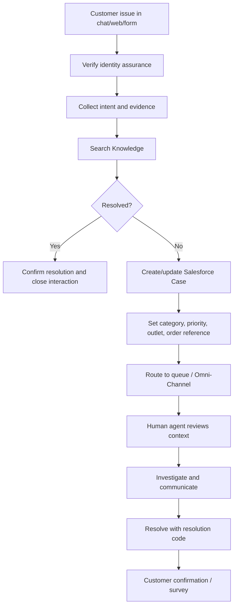

# 04 — Service Cloud Case, Knowledge, Routing and Handoff

## 1. Service lifecycle

## 2. Case model

Use standard Case unless a proven requirement demands a custom support object.

Recommended fields:
- `External_Order_Id__c` (Text, indexed/external reference as appropriate)
- `External_Customer_Id__c`
- `Outlet__c` (lookup to outlet reference object if approved)
- `Issue_Category__c` (restricted picklist)
- `Issue_Subcategory__c`
- `Customer_Identity_Level__c` (Guest / Authenticated / Step-up verified)
- `Agent_Interaction_Id__c`
- `Refund_Request_Reference__c`
- `Preferred_Contact_Channel__c`
- `Customer_Impact__c`
- `Resolution_Code__c`
- `Integration_Status__c` where asynchronous sync requires it.

Do not duplicate payment card data, CVV, full address or unnecessary order details into Case description.

## 3. Case categories

- Order not received / delayed.
- Missing item / wrong item.
- Food quality / packaging.
- Payment pending / failed / duplicated.
- Refund request.
- Cancellation/reschedule.
- Delivery partner issue.
- Account/login.
- Menu/allergen question.
- General feedback.

## 4. Priority and routing

Define routing matrix with business owner:
- P1: safety/allergen incident, suspected payment fraud, broad outage.
- P2: paid order not fulfilled, severe delivery failure, multiple customers affected.
- P3: missing/wrong item, refund follow-up, account access.
- P4: general feedback and non-urgent questions.

Priority must be derived from approved policy and agent/customer signals; agent cannot arbitrarily mark every issue urgent. Use queues by support function and outlet/region. Omni-Channel routing, presence, capacity and skills must be validated against licensing.

## 5. Human handoff payload

Include:
- verified customer/contact reference, or guest reference and assurance level;
- external order reference;
- Case number/ID after creation;
- issue category and customer-stated impact;
- concise conversation summary;
- actions attempted and verified results;
- relevant Knowledge articles;
- correlation ID;
- consent/contact preference.

Exclude raw secrets, full payment credentials and unrelated conversation content.

## 6. Knowledge governance

Each article needs:
- title, summary, audience, category;
- approved answer and exclusions;
- effective/review dates;
- owner and approver;
- related outlet/region if relevant;
- escalation trigger;
- version and publish status.

Use Knowledge for policy/how-to content, not live stock, prices or order state.

## 7. Case automation

Use Flow for deterministic lifecycle work:
- set initial Case fields;
- assign queue based on category/outlet;
- notify queue;
- set SLA milestone where entitled/configured;
- close only with required resolution fields;
- trigger customer survey only with consent and channel policy.

Use Apex only when Flow is insufficient or a reusable service boundary is required. Bulkify Apex and avoid recursive Case updates.

## 8. Service console layout

Recommended console:
- Case record page with customer and order context;
- related Cases and Knowledge;
- Agent interaction summary;
- order reference link to secure commerce admin view;
- refund review status (read-only unless approved workflow);
- Omni-Channel utility;
- macros/quick text for common responses.

## 9. Operational controls

- Define queue ownership, support hours and fallback queue.
- Define Case duplicate detection and merge policy.
- Define SLA calendar/time zone (outlet/local vs central support).
- Define Case retention and deletion/anonymization policy.
- Define customer notification channel and consent.
- Track first response, time to resolution, reopen rate and handoff abandonment.
